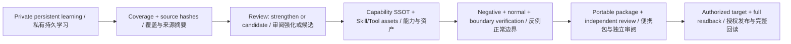

# AgentOS · Skills · Tools

Evidence-driven governance, a unified capability-linked asset inventory, and a weekly learning loop. / 以证据驱动的智能体治理、统一能力资产台账与每周学习闭环。

## Start / 开始使用

Python 3.9+ is required for the core tools; no pip dependency or administrator privilege is needed for offline bundle deployment. PowerShell source requires Windows PowerShell5.1+; it is not automatically executed. Optional visual scripts have separately listed dependencies.

```text
python -B tools/agentos_toolkit.py doctor
python -B tools/agentos_toolkit.py assets
python -B tools/verify_release.py --package <absolute-clone-path> --output <absolute-new-evidence-directory>
python -B tools/portable_install.py install --source <absolute-clone-path> --target <absolute-new-target> --dry-run
python -B tools/portable_install.py install --source <absolute-clone-path> --target <absolute-new-target>
python -B tools/portable_install.py rollback --target <absolute-target> --dry-run
```

Deployment copies verified files only. It does not change environment variables, agent clients, projects, services, security controls or scheduled tasks. Choose client/project integration explicitly after reading the governance entry. Legacy mutation-first installers are not distributed.

部署仅复制已校验文件，不改环境变量、客户端、项目、服务、安全控制或计划任务。客户端接入由使用者明确选择；旧先写后检查安装器不随包分发。

## Architecture / 架构



- `governance/AgentOS/`: core protocols, authoritative capability contracts and thin adapters.
- `capability-assets.json`: Skill/Tool version, entry, capability reference, dependency, side effect, license and hashes; no duplicate capability definitions.
- `catalog.json`: every discovered Skill and Skill-like entry, classified as exported, deduplicated or reference-only. Non-Skill AgentOS client entries and identity-missing documents are explicitly identified as `client_entry` or `unregistered_skill`; neither is routable or exported as a Skill. Inventory is not a capability certification.
- `tools/agentos_toolkit.py`: one entry point for setup, inventory, learning, deployment and publication.
- `tools/capability_assets.py`: strict asset gate and private evidence-bound lesson receipts; scan does not consume lessons.
- `tools/verify_release.py`: reproducible source/staged tests, Windows PowerShell5.1 checks and per-file security coverage; missing prerequisites remain not_run, not PASS.
- `portable-manifest.json`: complete public bundle hashes; `tools/portable_install.py` verifies, backs up and rolls back.
- `docs/weekly-workflow.md`, `docs/portable-install.md`, `docs/capability-assets.md`: interfaces, gates and limits.

## Publisher setup / 维护者配置

```text
python -B tools/agentos_toolkit.py init --policy <absolute-reviewed-policy.json>
python -B tools/agentos_toolkit.py scan
```

Start with `config/policy.example.json`; explicitly authorize your own repository identity and select bounded source roots. No credentials are stored in policy. GitHub authentication uses existing environment/credential-manager storage, only when publish is explicitly invoked. Core inspection and installation are offline.

以配置模板为起点，明确来源范围及自己授权的仓库身份。私有配置不含凭据。仅明确发布时使用现有凭据管理；检查与安装可离线运行。

## Rights and scope / 许可与边界

Owner-authored exported assets are MIT; unknown third-party rights remain reference-only. This is a sanitized text edition, not a backup of all installed third-party assets. Personal owner-report preferences are opt-in only. A configured native weekly task requires its host/app to be available; this repository does not install a daemon or guarantee future execution. See evidence/validation.json for the source-unit-test receipt only, and evidence/inventory.json for the current coverage state, including declared scope exclusions and verified link aliases. It is not a candidate-package release receipt; run tools/verify_release.py against the exact candidate and retain its output separately.

自有白名单采用 MIT，其余不推定授权。个人报告偏好为可选配置。本仓库不安装守护程序，也不保证机器关闭后执行。实测范围与未检项见证据。
